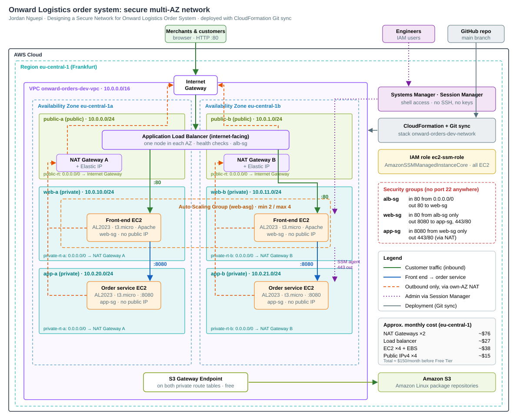

# Onward Logistics: Secure Order System Network

A highly available, secure AWS network for the Onward Logistics order system. Everything is built with CloudFormation and deployed by **CloudFormation Git sync** from this repository.

Research and design reasoning are in the discovery report: [`docs/discovery.pdf`](docs/discovery.pdf).

## Architecture



| Layer | Resources |
|---|---|
| Network | VPC `10.0.0.0/16` across **2 AZs**: 2 public, 2 private *web*, 2 private *app* subnets |
| Internet entry | Internet Gateway → internet-facing **Application Load Balancer** (only public component) |
| Front end | Auto Scaling Group (min 2, one per AZ) of Amazon Linux 2023 `t3.micro` in private web subnets; page shows owner name and lab name |
| Order services | 2 Amazon Linux 2023 `t3.micro` instances (one per AZ) in private app subnets, port `8080` open to front-end SG only |
| Outbound | **One NAT Gateway per AZ** (each AZ routes through its own) + free **S3 gateway endpoint** for package repos |
| Admin access | **SSM Session Manager**: IAM role with `AmazonSSMManagedInstanceCore`; no key pairs, no port 22 anywhere |

Traffic rules (security groups):

```
Internet --80--> ALB SG --80--> Web SG --8080--> App SG
                                Web/App SG --443/80--> internet (via NAT, outbound only)
```

## Repository layout

```
docs/discovery.pdf           Discovery report (committed before the build)
templates/network.yaml       Main stack: VPC, subnets, NAT, ALB, ASG, instances, SGs, IAM
deployment-file.yaml         Git sync deployment file (template path, parameters, tags)
bootstrap/gitsync-role.yaml  One-time stack: GitHub connection, Git sync role, execution role (managed policies only)
```

## Deploy

Region: **eu-central-1 (Frankfurt)**. This project has its own GitHub connection and its own roles; it shares nothing with other stacks in the account.

1. **Bootstrap (once).** Creates the GitHub connection `onward-orders-dev-github` (pending), the Git sync role and the CloudFormation execution role:
   ```bash
   aws cloudformation deploy --region eu-central-1 \
     --stack-name onward-orders-dev-gitsync-bootstrap \
     --template-file bootstrap/gitsync-role.yaml \
     --capabilities CAPABILITY_NAMED_IAM \
     --parameter-overrides OwnerName="Jordan Nguepi"
   aws cloudformation describe-stacks --region eu-central-1 \
     --stack-name onward-orders-dev-gitsync-bootstrap --query 'Stacks[0].Outputs'
   ```
2. **Approve the connection.** In the console (Frankfurt): Developer Tools > Settings > Connections > `onward-orders-dev-github` > **Update pending connection**, and give the GitHub app access to `danjor667/vpc`. The GitHub OAuth handshake is the only step that needs a browser.
3. **Create the Git sync stack.** In CloudFormation (Frankfurt), choose **Create stack** > **Sync from Git**, and set:
   - Stack name `onward-orders-dev-network`
   - Connection `onward-orders-dev-github`, repository `danjor667/vpc`, branch `main`
   - Deployment file path `deployment-file.yaml`
   - Git sync IAM role = `GitSyncRoleArn` output
   - Under stack options, IAM role = `CloudFormationExecutionRoleArn` output

After that, every push to `main` that changes the template or deployment file updates the stack `onward-orders-dev-network`.

| Role | Can do |
|---|---|
| `onward-orders-dev-gitsync-role` | Create and run change sets; pass **only** the execution role to CloudFormation. Trusts only this project's connection. |
| `onward-orders-dev-cfn-execution-role` | Build the VPC, EC2, load balancer and Auto Scaling resources in eu-central-1; manage **only** the `onward-orders-dev-ec2-*` instance role, which may only carry `AmazonSSMManagedInstanceCore`. |

## Prove the client checks

```bash
export AWS_REGION=eu-central-1
STACK=onward-orders-dev-network
out() { aws cloudformation describe-stacks --stack-name $STACK \
  --query "Stacks[0].Outputs[?OutputKey=='$1'].OutputValue" --output text; }
```

| Check | How to demonstrate |
|---|---|
| Front end reachable from the internet | `curl $(out FrontEndUrl)`. Refresh and the instance ID/AZ changes as the ALB balances across AZs |
| Front end survives a failure | Terminate one web instance: `aws ec2 terminate-instances --instance-ids <id>`. The site stays up and the ASG launches a replacement |
| No inbound from the internet to internal servers | Order service instances have no public IP; `App SG` only allows 8080 from `Web SG`; no SG has port 22 |
| Internal servers can download a package | `aws ssm start-session --target $(out OrderServiceInstanceAId)` → `sudo dnf install -y tree` |
| Admin without opening ports | Same Session Manager session, on each of `OrderServiceInstanceAId` / `OrderServiceInstanceBId` |
| Front end → order service path works | From a web instance session: `curl http://$(out OrderServiceAPrivateIp):8080` |
| Rebuild from the repository | Delete the stack, then let Git sync recreate it from `main` |

Session Manager from a laptop needs the [Session Manager plugin](https://docs.aws.amazon.com/systems-manager/latest/userguide/session-manager-working-with-install-plugin.html) for the AWS CLI.

## Cost

About **$147–155/month** in eu-central-1 (Frankfurt), mostly the two NAT Gateways. See the reasoning in the discovery report ([`docs/discovery.pdf`](docs/discovery.pdf), "Your chosen approach"). **Delete the stack when you are not using it.** NAT Gateways and the ALB bill by the hour.
